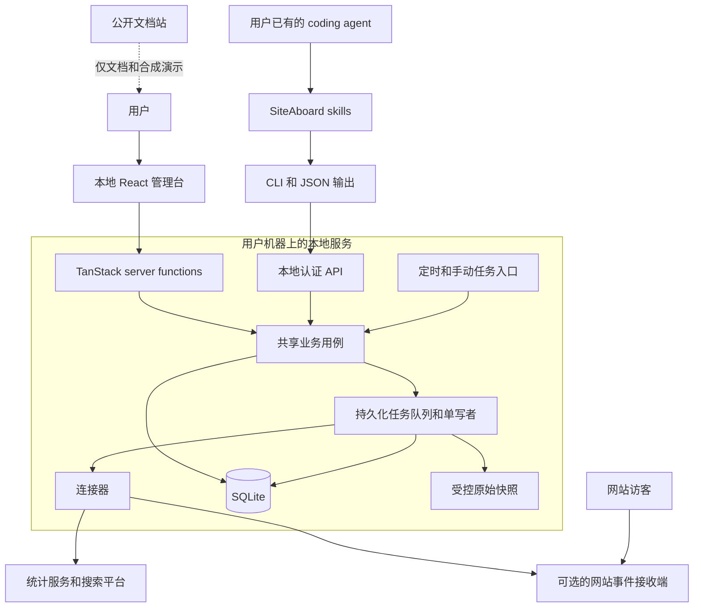

# SiteAboard 整体架构

状态：2026-10-24。已实现独立静态前端、合成演示、主题与中英文；以下本地服务、CLI、存储和连接器为目标架构，尚未实现。采用独立本地应用，UI、CLI 和 skills 共用一个业务核心。第一阶段验证可运行闭环，再增加外部集成；不依赖特定 agent 宿主。

## 1. 系统边界



本地服务是写入协调者；页面和 CLI 不自行另起采集器。外部模型不在系统必需依赖中，skills 由用户已有的 agent 执行。公开文档站不读取本地数据，也不承载管理 API。

## 2. 技术选型

| 层       | 初始选择                                                               | 原因与约束                                                                  |
| -------- | ---------------------------------------------------------------------- | --------------------------------------------------------------------------- |
| 语言     | TypeScript strict、ESM                                                 | 与已有可复用逻辑一致；核心不依赖 React                                      |
| UI       | React 19，手写 CSS 与现有 SVG 图表思路                                 | 先复用通用组件，控制 UI 依赖；提供表格与键盘访问                            |
| Web      | 当前 TanStack Router + Vite 静态 SPA；后续评估 TanStack Start 本地服务 | GitHub Pages 只部署静态演示；未来 server functions 是适配层，不承载指标定义 |
| 本地运行 | Node 26 系列作为首轮基线                                               | 首轮验证 `node:sqlite` 与构建产物；兼容范围由 CI 结果决定                   |
| 存储     | SQLite，WAL、参数化 SQL、显式迁移                                      | 小规模单用户工作负载；不引入外部数据库和 ORM                                |
| 包管理   | pnpm workspace                                                         | 一个仓库，少量职责明确的包；不引入额外构建编排系统                          |
| 测试     | Node test runner + TypeScript 执行工具；浏览器冒烟                     | 保护指标语义、同步恢复、隔离与核心用户路径                                  |
| 文档站   | 当前 Markdown + GitHub Pages 静态演示                                  | 文档生成框架到文档阶段再决定                                                |

前端依赖已锁定版本并提交 lockfile，从空项目安装，不复制旧 lockfile。本地服务依赖在 M1 验证后加入。SQLite 驱动隔离在 `core/storage`，避免把特定 Node API 散布到业务代码；查询规模增长后按测量结果决定是否移入 worker。

Python 不作为首版默认安装依赖。确有收益的既有脚本可以作为明确声明的可选连接器；普通接入和 demo 路径保持 Node 即可运行。

Node SQLite 与 TanStack 的当前能力参考：[Node SQLite](https://nodejs.org/api/sqlite.html)、[TanStack Node hosting](https://tanstack.com/start/latest/docs/framework/react/guide/hosting)。当前静态前端已经完成构建与浏览器检查；本地服务构建兼容性待 M1 验证。

## 3. 模块职责与依赖

| 目录                        | 负责                                                 | 禁止承担                                         |
| --------------------------- | ---------------------------------------------------- | ------------------------------------------------ |
| `apps/admin`                | 页面、server functions、本地 API、服务启动与资源释放 | 自己定义 UV/漏斗算法，直接拼 SQL                 |
| `apps/cli`                  | 参数校验、连接服务、结构化输出、退出码、启动命令     | 直接打开数据库写入、运行另一套采集器             |
| `packages/core/domain`      | 站点、指标、来源能力、时间与质量状态                 | React、HTTP、外部 SDK                            |
| `packages/core/application` | 接入、同步、查询、改进记录、复查等用例               | 依赖 UI、特定 agent 或连接器实现                 |
| `packages/core/storage`     | SQLite 迁移、查询仓储、备份与恢复                    | 把用户输入拼成 SQL，数据库重建覆盖用户记录       |
| `packages/core/runtime`     | 任务队列、writer 锁、调度、重试、日志                | 调用 LLM 完成普通同步                            |
| `packages/connectors`       | 授权检查、拉取、标准化、能力声明                     | 写数据库、决定跨来源指标合并规则                 |
| `skills`                    | 基于稳定 CLI 的任务步骤与验收                        | 私自定义指标、要求读取密钥、绕过权限调用生产接口 |
| `examples`                  | 合成站点、测试事件和可分享配置                       | 真实站点数据、账号标识、截图和凭证               |

`apps/admin` 是组合入口：构造 core、注册 connectors，再挂载 UI/API。connectors 只依赖 core 公共契约；core 通过接口使用它们，不反向导入具体连接器。CLI 只共享公开 DTO/错误契约，不导入存储实现。

当前根 package 管理前端工具，只有 admin 与 core 数据契约有代码；其余是职责预留目录。未来形成上述四个工作包，不为每个领域拆 npm 包。文档中的 `domain/application/storage/runtime` 是 core 内部目录，待实现时创建。

## 4. 进程与安装模型

目标是用户启动一个本地服务，即可打开 UI 和使用 CLI。开发使用 Vite；正式使用经过构建的 Node 服务，不要求长期运行开发服务器。

调度器从服务启动/关闭生命周期挂载，不能只存在于 Vite dev plugin 中，也不能在页面 loader 或请求中创建。M1 必须验证生产构建能启动、任务只启动一次、退出能释放锁。

默认绑定 `127.0.0.1`，开发端口建议 `4310`，支持显式覆盖。数据目录默认 `~/.siteaboard/`，由 `SITEABOARD_HOME` 覆盖；开发和测试使用独立临时目录。数据位置不依赖当前工作目录，不要求旁边有其他仓库。

服务取得数据目录级独占锁，所有写入经队列串行执行。网络拉取不长期占用 SQLite 事务；连接器返回批次后，数据、游标与成功状态在短事务中提交。重启将遗留 running 任务标为 interrupted，并按幂等规则恢复。

CLI 的 `doctor` 可离线检查环境；其余业务命令连接已启动服务。服务没运行时返回明确错误，不悄悄启动第二个 writer。单机模式优先；远程访问和多机同步不进入首版。

## 5. 数据模型与指标契约

| 数据组 | 核心记录                                         | 规则                                                       |
| ------ | ------------------------------------------------ | ---------------------------------------------------------- |
| 配置   | sites、connections、metric_definitions           | 站点时区、来源选择、事件字典带版本；数据库只存 secretRef   |
| 采集   | sync_runs、sync_cursors、source_snapshots        | 来源、范围、时间、状态、版本、去重键和错误分类             |
| 分析   | analytics_daily、event_facts、search_performance | 保留来源原生粒度；某连接器未提供事件时不伪造事件明细       |
| 运营   | issues、changes、reviews                         | 证据引用、改动时间、观察窗和复查状态；不会因重拉数据被删除 |
| 系统   | jobs、audit_log、schema_migrations               | 幂等标识、结果和执行者类型；凭证不进入日志                 |

以上是逻辑表分组，具体 DDL 在 M1/M2 按需要落地。迁移使用增量版本，不沿用“schema 变化便全库重建”的方式；重建派生统计不得删除运营记录。

所有查询返回：`schemaVersion`、`siteId`、`source`、`period`、`timezone`、`fetchedAt`、`dataThrough`、`quality`、`definitionVersion` 和 `evidenceRefs`，以及该查询的业务数据。

- `quality` 区分 complete / partial / stale / missing / unsupported；来源故障与最后一份有效数据分别记录。过期不自动等于无效。
- UV、session、PV、事件次数各有定义；provider 的独立访客不可跨天简单相加。某来源没有精确跨期去重时，明确不可用或标明估计。
- 流量来源不直接相加。选择主来源并记录生效范围；来源切换在图上标记，跨来源比较附口径提示。
- 搜索点击与站点访问分别展示。来源日历不同且没有小时级数据时，保留原生日期，不将日聚合强行换算成同一时区。
- 漏斗明确主体、顺序与窗口；只有聚合事件次数时展示计数对照，不伪装为用户转化漏斗。
- 回访指标依赖可用且被允许的跨期标识；每日轮换标识不能据此计算跨日留存。
- 修订历史保留数据版本；复盘记录当时证据与查询定义，不把当前查询结果冒充历史快照。

## 6. 连接器契约与首批来源

每个连接器实现 `describe`、`validateConfig`、`checkConnection`、`pull`、`normalize`，并声明支持的维度、时间粒度、事件级能力、配额、授权方式和费用类别。这里是设计接口名称，尚无实现。

`pull` 接收站点、时间范围、游标和受控凭证引用，返回批次、下一游标、覆盖范围与质量信息；由运行层决定重试和落库。服务端限制参数大小、超时、重试与允许访问的目标，不执行连接器数据里的指令。

先做 `fixture/import` 保证无账号体验，再做 GSC 和一个真实流量连接器。默认优先评估既有 Plausible 适配的通用部分以缩短验证路径；这不表示要求用户订阅 Plausible。M2 锁定真实适配器前检查目标用户已有来源、官方 API 与授权体验；Umami/GA4 是候选，不同时全做。

现有付费来源可接入，不构成“无需购买统计服务”的唯一实现。自有采集路径在 M3 独立交付，达到可用前不会宣传为已有能力。

## 7. CLI 与 agent

拟议 CLI 程序名为 `siteaboard`，以下命令尚未实现：

```text
siteaboard serve
siteaboard doctor --json
siteaboard sites list --json
siteaboard sync --site demo --source fixture --json
siteaboard metrics summary --site demo --from YYYY-MM-DD --to YYYY-MM-DD --json
siteaboard search summary --site demo --from YYYY-MM-DD --to YYYY-MM-DD --json
siteaboard issues create --input issue.json --dry-run --json
siteaboard reviews export --site demo --json
```

CLI JSON 输出为单个 envelope：`schemaVersion`、`ok`、`data`、`warnings`、`error`；日志走 stderr。写操作支持幂等键；退出码区分成功、输入错误、服务不可达、来源失败和部分成功，具体枚举随首个 CLI 契约测试定稿。

三项首批 skills：连接一个站点、检查埋点、做一次运营复盘。每项列出前置条件、稳定命令、读写边界、失败恢复和验收。接入阶段尚不支持的来源明确报告，禁止 agent 自编成功结果。

查询默认返回聚合与必要证据，完整原始数据导出需显式动作。外部内容始终作为数据处理。修改用户网站代码由已有 agent 在用户授权的目标仓库里形成 diff；SiteAboard 首版保存改动与复查记录，不提供任意 shell 或自动生产发布接口。

不自建模型网关、对话界面、向量库或 agent 编排平台。MCP 以后作为同一业务 API 的薄适配，仅在 CLI 工作流确实需要它时加入。

## 8. 本地访问与凭证

“只监听 localhost”并不替代请求校验。API 与 server functions 都经统一访问策略：Host allowlist、来源校验、读取接口鉴权、写入的 CSRF 防护；禁用通配 CORS。

CLI 使用本机权限限制文件中的随机凭证，UI 通过一次性本地配对建立会话；具体握手在 M1 设计并测试，不能把长期 token 放入 URL、浏览器持久化存储或日志。权限模型防止浏览器跨站访问和误操作，不宣称能隔离同一 OS 用户下的恶意本机进程。

外部 API 凭证经过 SecretStore 接口：优先系统凭证库；开发阶段允许明确 opt-in 的进程环境变量。UI 只收到配置状态与脱敏标识，agent 不读取密钥值。OAuth 授权、回调、刷新与撤销是连接器验收的一部分，不把开发者自有凭证分发给用户。

本地 SQLite、原始快照、备份、令牌、日志和截图不进入 Git；演示只用合成数据。原始快照设置保留期、体积上限与删除机制，过滤敏感响应头，不默认永久保存所有外部响应。

## 9. 可选的网站端采集

事件采集有独立信任边界：公开事件接收接口只负责有限事件，管理查询与导出另行认证。浏览器中的 siteId 不是秘密；来源白名单也不是防伪保证，需要速率/大小限制、事件白名单与异常流量标识。

最小事件契约包含版本、事件 ID、站点、事件名、时间和允许的属性。默认不收集表单内容、完整查询串、邮件或长期个人标识；URL/属性先按白名单处理。测试事件必须能与正式流量分开，按 `(siteId, eventId)` 去重。

接收端部署在用户已有网站后端，或可选的轻量云端模板；本地管理台只负责授权拉取。M3 再根据首批站点框架选择首个部署适配器，不把特定云厂商作为 core 依赖。

## 10. 兼容、迁移与验证

从既有内部工具逐模块提取：优先指标纯函数、时间处理、图表、查询和采集能力；每次提取带必要测试。移除私有路径、产品事件编码、个人身份、内部域名、机器配置与研究数据。新项目不会运行时导入旁边的内部仓库。

保留旧工具独立运行，不让两个服务写同一数据库。新数据目录从合成数据或用户授权的数据源建立；导入历史库需独立迁移方案，不自动复制。

发布门槛包括：干净目录构建与生产启动、缺失/失败状态、重复同步去重、中断恢复、迁移与备份恢复、UI/CLI 结果一致、跨站请求拒绝、客户端不含 secret、agent 复盘引用真实证据。macOS 首先实测；Linux/Windows 在对应 CI 和安装验证完成前标记未验证。
